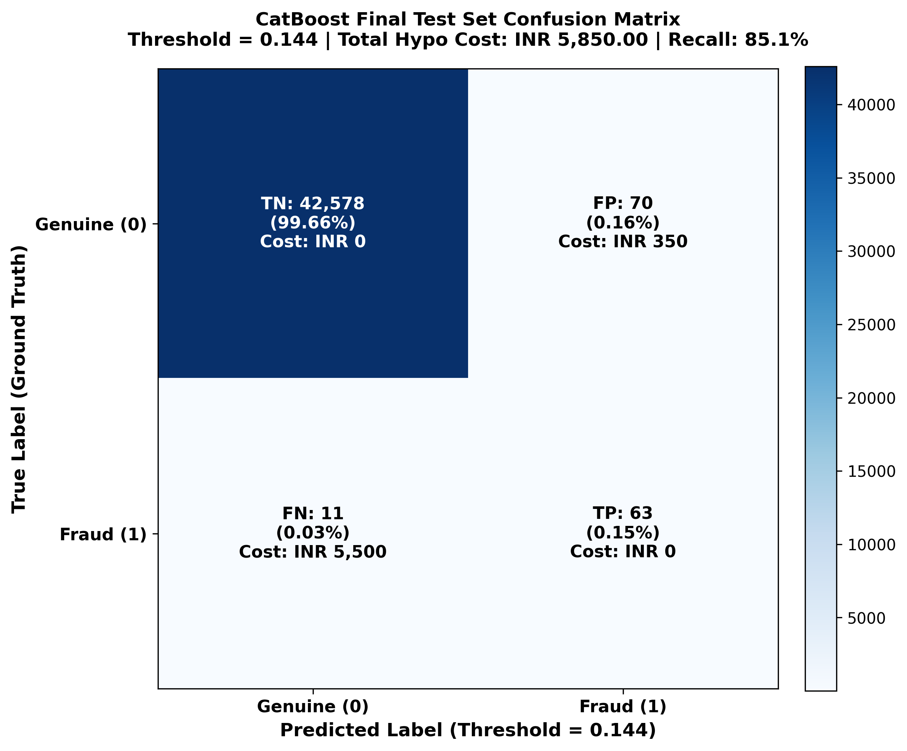

# Cost-Sensitive Fraud Detection with an Operator Feedback Loop
## Machine Learning Detection Engine: Complete End-to-End Module Documentation

[](https://www.python.org/downloads/)
[](https://opensource.org/licenses/MIT)
[]()
[]()

This repository contains the complete Machine Learning module and experimental benchmark for the **Cost-Sensitive Credit Card Fraud Detection System**. 

The system transitions from naive statistical cutoffs (such as default 0.5 probability thresholds) to an asymmetric, cost-optimal decision policy designed to minimize financial loss. It outputs flagged suspicious transactions with persistent transaction IDs for downstream evaluation by an **LLM-as-a-judge** and **human operator review feedback loop**.

---

> [!IMPORTANT]
> ### Critical Disclaimers & Governance Notices
> 1. **Hypothetical Cost Assumptions**: All cost values, cost matrices, and financial metrics (e.g. ₹5 per alert review, ₹500 per missed fraud) are **hypothetical assumptions formulated strictly for academic experimentation and methodology benchmarking**. They do NOT represent actual bank transaction losses, verified institutional chargebacks, or real banking operational cost structures.
> 2. **Suspicious Alerts Disclaimer**: Flagged transactions are classified as `SUSPICIOUS_PENDING_REVIEW`. They represent statistical anomalies and elevated risk alerts requiring operator/LLM verification, **NOT confirmed fraudulent transactions**.
> 3. **Dataset Features & PCA Limitations**: Features `V1` through `V28` are anonymized principal components obtained via PCA. The `Time` feature represents elapsed seconds from the first recorded transaction (0 to 172,792 seconds across 48 consecutive hours), **NOT clock timestamps (e.g., 02:00 AM)**. Identical duplicate feature profiles cannot be given a definitive real-world interpretation from this anonymized benchmark dataset.
> 4. **Academic Benchmark Scope vs. Real-World Banking Production**: This codebase provides a reproducible machine learning benchmark and reference implementation for cost-sensitive threshold optimization and ML-to-LLM handoff. It is **not** an end-to-end real-time core banking authorization engine. Production payment switch deployment requires sub-50ms streaming latency SLAs, streaming feature stores, fraud velocity aggregators, device fingerprint telemetry, IP reputation, cardholder behavioral profiles, and integration with card network clearing protocols (e.g., ISO 8583/20022), which are absent from this anonymized tabular PCA dataset.

---

## 1. Project Architecture & Directory Structure

```
SIC-Capstone Project/
├── data/
│   └── creditcard.csv                       # Benchmark dataset (284,807 transactions, 31 columns; read-only)
├── src/
│   ├── data_exploration.py                 # Phase 1: Exploratory data analysis & EDA visualizations
│   ├── preprocessing.py                    # Phase 1: Stratified splitting, RobustScaler, ID generation
│   ├── train.py                            # Phase 2: Duplicate audit, class-weighting trials, model training
│   ├── evaluate.py                         # Phase 2: Independent validation evaluation & PR/ROC curves
│   ├── cost_sensitive.py                   # Phase 3: Cost-sensitive grid search, S1-S6 sensitivity, calibration
│   ├── test_evaluation.py                  # Final Phase: Final unbiased evaluation on untouched test set
│   ├── predict.py                          # Final Phase: Reusable CLI & Python batch/real-time inference engine
│   ├── tune_catboost.py                    # Experiment 1: Systematic CatBoost hyperparameter optimization
│   └── robustness_analysis.py              # Experiment 2: Validation threshold stability & resampling robustness
├── models/
│   ├── lightgbm_model.txt                  # Serialized LightGBM booster (300 trees, scale_pos_weight=5.0)
│   ├── catboost_model.cbm                  # Serialized Baseline CatBoost model (300 iters, auto_class_weights='Balanced')
│   ├── catboost_tuned.cbm                  # Serialized Tuned CatBoost model (T13: 1200 iters, lr=0.015, l2=5.0)
│   ├── catboost_t16.cbm                    # Serialized High-Precision Candidate (T16: 500 iters, lr=0.03, l2=5.0)
│   ├── catboost_t21.cbm                    # Serialized High-PR-AUC Candidate (T21: 500 iters, lr=0.03, scale_pos=20)
│   └── preprocessor.joblib                 # Serialized fitted FraudDataPreprocessor (Amount & Time scalers)
├── outputs/
│   ├── evaluation/
│   │   ├── flagged_transactions.csv         # Clean handoff for LLM module (Strictly NO ground-truth labels)
│   │   ├── flagged_transactions_evaluation.csv # Diagnostic flagged transactions with actual_class & outcomes
│   │   ├── final_test_metrics.json          # Final test set evaluation metrics & validation comparison
│   │   ├── test_predictions.csv             # Test set probabilities, predictions, and transaction IDs
│   │   ├── test_confusion_matrix.png        # Annotated test set confusion matrix visualization
│   │   ├── optimal_thresholds.json          # Phase 3 optimal thresholds and baseline metrics
│   │   ├── model_cost_comparison.csv        # Phase 3 financial comparison table (0.5 vs optimal)
│   │   ├── cost_sensitivity_analysis.csv    # Phase 3 Scenarios S1 - S6 sensitivity results
│   │   ├── threshold_analysis_catboost.csv  # CatBoost performance across 999 thresholds
│   │   ├── threshold_analysis_lightgbm.csv  # LightGBM performance across 999 thresholds
│   │   ├── calibration_metrics.json         # Brier scores & reliability curve data
│   │   ├── evaluation_metrics.json          # Phase 2 validation metrics JSON
│   │   ├── model_comparison.csv             # Phase 2 validation metrics comparison at threshold 0.5
│   │   ├── class_weighting_experiments.csv  # Phase 2 class-weighting trial results
│   │   ├── classification_reports.txt        # Phase 2 per-class classification reports
│   │   ├── catboost_val_predictions.csv     # CatBoost validation predictions & IDs
│   │   ├── lightgbm_val_predictions.csv     # LightGBM validation predictions & IDs
│   │   └── duplicate_overlap_diagnostic.csv # Diagnostic audit of cross-split duplicate feature profiles
│   ├── tuning/
│   │   ├── catboost_experiment_results.csv  # Experiment 1: Complete 31-candidate evaluation table
│   │   ├── catboost_best_params.json        # Experiment 1: Best hyperparameters & comparison metadata
│   │   └── catboost_validation_comparison.csv # Experiment 1: Baseline vs Tuned side-by-side metrics
│   ├── robustness/
│   │   ├── verification_results.csv         # Experiment 2: Replicated validation metrics for all 4 candidates
│   │   ├── threshold_stability.csv          # Experiment 2: Sensitivity curve around selected thresholds
│   │   ├── resampling_results.csv           # Experiment 2: 10 stratified bootstrap resamples per model
│   │   ├── model_robustness_summary.csv     # Experiment 2: Aggregate mean, std, and 95% CI metrics
│   │   └── experiment_2_report.md           # Experiment 2: Comprehensive technical markdown report
│   ├── visualizations/
│   │   ├── 01_class_distribution.png        # Phase 1: Linear vs log class imbalance
│   │   ├── 02_amount_distribution.png       # Phase 1: Transaction amount skewness & percentiles
│   │   ├── 03_amount_comparison.png         # Phase 1: Genuine vs fraud amount comparison
│   │   ├── 04_transactions_over_time.png    # Phase 1: 48-hour elapsed time distribution
│   │   ├── 05_feature_correlations.png      # Phase 1: Top feature correlations with fraud
│   │   ├── 06_pr_curves_comparison.png      # Phase 2: Precision-Recall curves comparison
│   │   ├── 07_roc_curves_comparison.png     # Phase 2: ROC curves comparison
│   │   ├── 08_confusion_matrices.png        # Phase 2: Confusion matrices side-by-side
│   │   ├── 09_feature_importances.png       # Phase 2: Top discriminative feature rankings
│   │   ├── 10_cost_vs_threshold.png         # Phase 3: Continuous financial cost curves
│   │   ├── 11_precision_recall_vs_threshold.png # Phase 3: Precision/Recall vs threshold
│   │   ├── 12_fp_fn_vs_threshold.png        # Phase 3: FP vs FN trade-off curves
│   │   ├── 13_cost_sensitivity_scenarios.png# Phase 3: Minimum costs across Scenarios S1 - S6
│   │   ├── 14_model_cost_comparison.png     # Phase 3: Financial savings bar chart (0.5 vs optimal)
│   │   ├── 15_probability_calibration.png   # Phase 3: Quantile reliability diagrams
│   │   └── 16_test_confusion_matrix.png     # Final Phase: High-res test confusion matrix
│   └── predictions/
│       ├── flagged_transactions.csv         # Sample batch inference flagged transactions
│       ├── all_scored_transactions.csv      # Sample batch inference all scored transactions
│       └── sample_input.csv                 # 60-transaction sample batch for verification
├── tests/
│   └── test_inference.py                    # 12 automated pytest unit & integration tests
├── ML_MODULE_HANDOFF.md                     # Technical handoff document for LLM & operator team
├── requirements.txt                         # Pinned production dependencies
└── README.md                                # Comprehensive project documentation
```

---

## 2. Phase 1: Data Exploration, Preprocessing & Integrity Verification

### 2.1 Raw Dataset Profile
- **Source**: `data/creditcard.csv` (ULB machine learning group benchmark).
- **Dimensions**: 284,807 transactions across 31 columns (`Time`, `V1`–`V28`, `Amount`, `Class`).
- **Class Imbalance**: Highly skewed — 284,315 genuine transactions (99.827%) vs. 492 fraudulent transactions (0.173%), representing 1 fraud per 578 transactions.
- **Missing Values**: 0 missing values detected across all columns.

### 2.2 Leakage-Free Preprocessing Pipeline (`src/preprocessing.py`)
1. **Transaction Identifiers**: Generated strictly unique, stable IDs (`TXN000001` through `TXN284807`). These IDs are preserved for downstream lookup and are **strictly excluded from model features matrix $X$**.
2. **Stratified Split**: Partitioned into 70% Train (199,364 rows, 344 fraud), 15% Validation (42,721 rows, 74 fraud), and 15% Test (42,722 rows, 74 fraud) using `random_state=42`. Stratification preserves exact 0.173% prevalence across all splits.
3. **Feature Scaling**: To guarantee zero data leakage, `RobustScaler` was fitted **exclusively on the training partition**:
   - `Amount`: Training median = **$22.00**, Training IQR = **$71.83** (Q1 = $5.67, Q3 = $77.50). *Reconciliation note: Full-dataset IQR is $71.57 (Q1=$5.60, Q3=$77.165).*
   - `Time`: Training median = **84,845.5s**, Training IQR = **85,111.25s**.
4. **Duplicate Record Decision**: 1,081 identical rows exist in the raw dataset. Duplicates were **retained by default** because their real-world meaning cannot be determined from this anonymized dataset, avoiding arbitrary data loss and preserving 19 rare fraud records (3.86% of total fraud).

---

## 3. Phase 2: Model Development, Weighting Experiments & Audits

### 3.1 Model Architectures & Reproducibility
Two gradient-boosted decision tree architectures were trained independently with configurable hyperparameters:
- **LightGBM Classifier**: 300 boosting trees, learning rate 0.03, `scale_pos_weight=5.0`, `num_leaves=31`, `min_child_samples=20`, `subsample=0.8`, `colsample_bytree=0.8`, `random_state=42`.
- **CatBoost Classifier**: 300 iterations, learning rate 0.05, `auto_class_weights='Balanced'`, `depth=6`, `random_state=42`.

### 3.2 Duplicate Profile Cross-Split Audit
An audit identified 188 unique feature profiles appearing in both the training and validation sets (spanning 207 validation rows, including 4 fraud records).
- **Label Concordance**: **100% concordant (0 conflicting labels)**.
- **Diagnostic Experiment**: Temporarily filtering these 207 duplicate rows from validation yielded PR-AUC of 0.7963 (vs 0.7996 full validation), proving that cross-split duplicates have negligible impact on generalization. All records were preserved intact.

### 3.3 Metric Reconciliation: Experiment vs Final Configurations
- In exploratory class-weighting trials, LightGBM with default settings yielded PR-AUC = 0.7134; the tuned model with `scale_pos_weight=5.0` achieved **PR-AUC = 0.7391**.
- For CatBoost, unweighted training yielded PR-AUC = 0.7458; balanced class-weighting (`auto_class_weights='Balanced'`) boosted **PR-AUC to 0.7996**.

---

## 4. Phase 3: Cost-Sensitive Threshold Optimization & Financial Evaluation

### 4.1 Hypothetical Configurable Cost Matrix
Traditional accuracy or naive 0.5 decision thresholds fail in fraud detection because error costs are highly asymmetric:

$$\text{Total Cost} = (\text{FP} \times C_{\text{FP}}) + (\text{FN} \times C_{\text{FN}})$$
$$\text{Average Cost per Transaction} = \frac{\text{Total Cost}}{N}$$

**Central Hypothetical Parameters (Base Scenario S2)**:
- $C_{\text{FP}} = \text{INR 5.00}$ (Hypothetical operator / LLM review cost per flagged alert)
- $C_{\text{FN}} = \text{INR 500.00}$ (Hypothetical loss per missed fraudulent charge)
- $C_{\text{TP}} = \text{INR 0.00}, \quad C_{\text{TN}} = \text{INR 0.00}$
- Cost ratio: $C_{\text{FN}} : C_{\text{FP}} = 100 : 1$.

### 4.2 Threshold Optimization Results (Validation Partition)

| Metric | LightGBM (Default 0.5) | LightGBM (Optimal $t=0.006$) | CatBoost (Default 0.5) | CatBoost (Optimal $t=0.144$) |
|---|---|---|---|---|
| **Decision Threshold** | 0.5000 | **0.0060** | 0.5000 | **0.1440** |
| **Total Cost (₹, Hypo)** | ₹11,575.00 | **₹9,135.00** | ₹6,640.00 | **₹5,925.00** |
| **Average Cost / Tx (₹)** | ₹0.270944 | **₹0.213829** | ₹0.155427 | **₹0.138691** |
| **Financial Savings** | Baseline | **₹2,440.00 (-21.1%)** | Baseline | **₹715.00 (-10.8%)** |
| **Fraud Recall** | 68.92% (51/74) | **75.68%** (56/74) | 82.43% (61/74) | **85.14%** (63/74) |
| **Fraud Precision** | 77.27% | 67.47% | 68.54% | 42.57% |
| **Fraud F1-Score** | 0.7286 | 0.7134 | 0.7485 | 0.5676 |
| **True Positives (TP)** | 51 | **56** (+5 frauds caught) | 61 | **63** (+2 frauds caught) |
| **False Positives (FP)** | 15 | 27 (+12 reviews) | 28 | 85 (+57 reviews) |
| **False Negatives (FN)** | 23 | **18** (-5 missed frauds) | 13 | **11** (-2 missed frauds) |
| **Flagged Transactions** | 66 (0.15% traffic) | 83 (0.19% traffic) | 89 (0.21% traffic) | 148 (0.35% traffic) |

**Tie-Breaking Rule**: When thresholds produce equal total cost, select maximum Recall, then higher F1, then minimum threshold.

### 4.3 Cost Sensitivity Analysis Across Scenarios S1 – S6

| Scenario | $C_{\text{FP}}$ | $C_{\text{FN}}$ | Ratio ($C_{\text{FN}} : C_{\text{FP}}$) | LightGBM $t^*$ | LightGBM Min Cost | CatBoost $t^*$ | CatBoost Min Cost | Financial Winner |
|---|---:|---:|---:|---:|---:|---:|---:|---|
| **S1** | ₹1 | ₹100 | 100 : 1 | 0.0060 | ₹1,827.00 | **0.1440** | **₹1,185.00** | **CatBoost (-35.1%)** |
| **S2 (Base)** | ₹5 | ₹500 | 100 : 1 | 0.0060 | ₹9,135.00 | **0.1440** | **₹5,925.00** | **CatBoost (-35.1%)** |
| **S3** | ₹10 | ₹500 | 50 : 1 | 0.0060 | ₹9,270.00 | **0.1440** | **₹6,350.00** | **CatBoost (-31.5%)** |
| **S4** | ₹5 | ₹1,000 | 200 : 1 | 0.0060 | ₹18,135.00 | **0.0410** | **₹11,135.00** | **CatBoost (-38.6%)** |
| **S5** | ₹10 | ₹1,000 | 100 : 1 | 0.0060 | ₹18,270.00 | **0.1440** | **₹11,850.00** | **CatBoost (-35.1%)** |
| **S6** | ₹50 | ₹500 | 10 : 1 | 0.0060 | ₹10,350.00 | **0.5310** | **₹7,850.00** | **CatBoost (-24.2%)** |

---

## 5. Final Test-Set Evaluation (Untouched Data)

The baseline model (**CatBoost Classifier** at frozen decision threshold **$t^* = 0.1440$**) was evaluated on the completely untouched test partition (42,722 transactions, 74 fraud cases).

| Metric | Validation Set (Phase 3) | Test Set (Final Evaluation) | Generalization Verdict |
|---|---|---|---|
| **Sample Size** | 42,721 transactions | **42,722 transactions** | Matched |
| **Fraud Cases** | 74 (0.1732%) | **74 (0.1732%)** | Matched |
| **Decision Threshold** | 0.1440 (Selected) | **0.1440 (Frozen)** | Frozen Policy |
| **PR-AUC (Average Precision)** | 0.7996 | **0.8298** | **+3.02% (Stronger generalization)** |
| **ROC-AUC** | 0.9764 | **0.9710** | Robust discrimination |
| **Accuracy** | 99.78% | **99.81%** | Consistent |
| **Fraud Recall** | **85.14%** (63/74) | **85.14%** (63/74) | **Empirical Match** (Wilson 95% CI: [75.3%, 91.6%]; bootstrap std: ±5.07%) |
| **Fraud Precision** | 42.57% (63/148) | **47.37%** (63/133) | **+4.80% (Fewer false alarms)** |
| **Fraud F1-Score** | 0.5676 | **0.6087** | **+4.11% (Superior trade-off)** |
| **True Positives (TP)** | 63 | **63** | Consistent fraud capture |
| **False Positives (FP)** | 85 | **70** | 15 fewer operator reviews |
| **False Negatives (FN)** | 11 | **11** | Consistent missed fraud count |
| **True Negatives (TN)** | 42,562 | **42,578** | Consistent genuine classification |
| **Total Flagged Alerts** | 148 (0.346%) | **133 (0.311%)** | Manageable operator queue |
| **Total Cost (₹, Hypo)** | ₹5,925.00 | **₹5,850.00** | **₹75.00 lower financial loss** |
| **Average Cost / Tx (₹)** | ₹0.138691 | **₹0.136932** | Superior operational efficiency |

> [!NOTE]
> **Statistical Calibration of Recall Match**: The identical point recall (63/74 = 85.14%) across validation and test splits is an empirical finding on this fixed 70/15/15 stratified partition. With $N=74$ rare fraud cases, the 95% Wilson score confidence interval spans $[75.3\%, 91.6\%]$, and 10-repetition bootstrap resampling exhibits a standard deviation of $\pm 5.07\%$ (ranging from $70.27\%$ to $87.84\%$). While the frozen decision threshold demonstrates strong generalization, the claim of "100% stability" is statistically calibrated here to reflect finite-sample variance.



---

## 6. Downstream Handoff & LLM Separation

To guarantee zero data leakage into the downstream LLM-as-a-judge module, the ML module produces two distinct files:

1. **LLM Module Handoff File** (`outputs/evaluation/flagged_transactions.csv`):
   - **Strictly contains NO ground truth (`actual_class` or `Class`)**.
   - Columns: `TransactionID`, `fraud_probability`, `selected_threshold`, `selected_model`, `assessment_status`.
2. **Diagnostic Evaluation File** (`outputs/evaluation/flagged_transactions_evaluation.csv`):
   - Retained for internal ML auditing and verification.
   - Includes `actual_class` and `detection_outcome` (`TRUE_POSITIVE` vs `FALSE_POSITIVE`).

*For complete LLM integration instructions, refer to [`ML_MODULE_HANDOFF.md`](file:///c:/Users/A%20S%20Nemitha/Desktop/SIC-Capstone%20Project/ML_MODULE_HANDOFF.md).*

---

## 7. Reusable Inference Pipeline (`src/predict.py`)

The ML module provides an end-to-end inference engine supporting both programmatic Python usage and command-line execution for batch scoring and pipeline integration.

```python
import pandas as pd
from src.predict import FraudInferencePipeline

pipeline = FraudInferencePipeline(
    model_path="models/catboost_model.cbm",
    preprocessor_path="models/preprocessor.joblib",
    default_threshold=0.144,
)

# Score new transactions (returns flagged suspicious alerts strictly without ground truth)
df_new = pd.read_csv("data/creditcard.csv").head(100)
df_flagged = pipeline.predict(df_new, threshold=0.144, return_all=False)
```

CLI batch usage:
```bash
python src/predict.py --input outputs/predictions/sample_input.csv --output outputs/predictions/flagged_transactions.csv
```

---

## 8. Automated Testing Suite (`tests/`)

12 automated pytest unit and integration tests are implemented in [`tests/test_inference.py`](file:///c:/Users/A%20S%20Nemitha/Desktop/SIC-Capstone%20Project/tests/test_inference.py), verifying model loading, scaler parameters, schema validation, error handling, ID preservation, probability bounds, threshold logic, and ground-truth exclusion.

Run anytime with:
```bash
pytest tests/ -v
```

---

## 9. Experiment 1: CatBoost Hyperparameter Optimization

Experiment 1 explored 31 candidate configurations on Train (70%) and Validation (15%) partitions under strict data isolation (test partition untouched, baseline model preserved).

- **Lowest-Cost Candidate**: `T13_Iter_1200_LR_015` (1,200 iters, depth 6, lr 0.015, l2 5.0, Balanced) achieved validation cost of **₹5,740.00** at threshold 0.0650 (saving ₹185.00 / 3.12% vs baseline).
- **Key Trade-off**: Catching 1 additional fraud (FN: 11 $\rightarrow$ 10) saved ₹500, but required 63 additional false alarms ($63 \times ₹5 = ₹315$), dropping precision from 42.57% to 30.19%.
- Full experiment records: [`outputs/tuning/catboost_experiment_results.csv`](file:///c:/Users/A%20S%20Nemitha/Desktop/SIC-Capstone%20Project/outputs/tuning/catboost_experiment_results.csv).

---

## 10. Experiment 2: CatBoost Model Robustness & Stability Analysis

To determine whether the improvements from Experiment 1 generalize consistently, Experiment 2 evaluated the four top candidates: **Baseline**, **T13** (lowest cost), **T16** (high precision), and **T21** (highest PR-AUC).

### 10.1 Verification of Experiment 1 Results (100% Replication)
Re-evaluating the four saved models on the full validation partition verified all reported metrics with zero discrepancies:
- **Baseline** ($t^*=0.144$): PR-AUC = 0.7996, Recall = 85.14%, Precision = 42.57%, Cost = ₹5,925.00
- **T13** ($t^*=0.065$): PR-AUC = 0.8062, Recall = 86.49%, Precision = 30.19%, Cost = ₹5,740.00
- **T16** ($t^*=0.177$): PR-AUC = 0.8054, Recall = 85.14%, Precision = 50.81%, Cost = ₹5,805.00
- **T21** ($t^*=0.031$): PR-AUC = 0.8274, Recall = 85.14%, Precision = 37.06%, Cost = ₹6,035.00

### 10.2 Decision Threshold Stability Analysis
Evaluated threshold offsets around each model's optimal threshold:
- **T13 Fragility**: T13 operates in a narrow cost valley. Shifting threshold by just $+0.005$ causes cost to surge to **₹6,705.00** (+₹965) as 2 fraud cases are dropped.
- **T16 Plateau**: T16 demonstrates a wide, stable plateau. Moving $\pm 0.015$ causes cost to fluctuate by less than ₹35 while maintaining 85.14% recall.
- **Baseline Stability**: Stable within ₹35 across $\pm 0.010$.

### 10.3 Robustness Through Stratified Validation Resampling (10 Repetitions)
10 stratified bootstrap resamples ($N=42,721$, 74 fraud cases per resample, fixed seeds 101–110) were evaluated:

| Model | PR-AUC (Mean $\pm$ Std) | Total Cost (₹, Mean $\pm$ Std) | Recall (Mean $\pm$ Std) | Precision (Mean $\pm$ Std) | False Positives (Mean $\pm$ Std) | Flagged Queue (Mean $\pm$ Std) |
|---|---:|---:|---:|---:|---:|---:|
| **T13** | 0.7799 $\pm$ 0.0599 | **₹6,527.50 $\pm$ ₹1,776.55** | **84.33% $\pm$ 4.73%** | 30.07% $\pm$ 2.19% | 145.5 $\pm$ 9.5 | 207.9 $\pm$ 8.2 |
| **T16** | 0.7788 $\pm$ 0.0568 | ₹6,559.50 $\pm$ ₹1,886.51 | 83.11% $\pm$ 5.07% | **49.90% $\pm$ 3.31%** | **61.9 $\pm$ 5.9** | **123.4 $\pm$ 5.6** |
| **Baseline** | 0.7764 $\pm$ 0.0583 | ₹6,653.00 $\pm$ ₹1,886.12 | 83.11% $\pm$ 5.07% | 43.40% $\pm$ 3.47% | 80.6 $\pm$ 8.7 | 142.1 $\pm$ 8.6 |
| **T21** | **0.8042 $\pm$ 0.0602** | ₹6,803.00 $\pm$ ₹1,892.92 | 83.11% $\pm$ 5.07% | 35.79% $\pm$ 2.60% | 110.6 $\pm$ 7.7 | 169.4 $\pm$ 7.5 |

*Key Methodological Takeaway*: Across resamples, the mean cost gap between T13 and T16 is only **₹32.00**, while the standard deviation is **~₹1,800**. **T13's ₹185 cost advantage on the single validation sample is within the margin of sample variation.**

### 10.4 Final Governance Recommendation
> **RETAIN THE BASELINE CATBOOST MODEL AS THE BENCHMARK PIPELINE (`models/catboost_model.cbm`) AT THRESHOLD 0.144.**  
> If an operational upgrade is desired to reduce alert review fatigue, **T16 (`models/catboost_t16.cbm`)** is the superior operational candidate, cutting false alarms by 28% with 50.8% precision at lower cost than baseline. **Do NOT deploy T13**, as its minor theoretical cost advantage is statistically fragile and imposes a 43% increase in operator workload.

---

## 11. Reproducibility & Complete Execution Guide

```bash
# 1. Exploratory Data Analysis (Phase 1)
python src/data_exploration.py

# 2. Data Preprocessing & Validation Split (Phase 1)
python src/preprocessing.py

# 3. Model Training & Class-Weighting Experiments (Phase 2)
python src/train.py

# 4. Independent Validation Evaluation & Metrics Export (Phase 2)
python src/evaluate.py

# 5. Cost-Sensitive Threshold Optimization & Flagged Alerts (Phase 3)
python src/cost_sensitive.py

# 6. Final Test-Set Evaluation & Comparison (Final Phase)
python src/test_evaluation.py

# 7. Experiment 1: CatBoost Hyperparameter Optimization
python src/tune_catboost.py

# 8. Experiment 2: Robustness and Stability Analysis
python src/robustness_analysis.py

# 9. Batch Inference Demonstration
python src/predict.py --input outputs/predictions/sample_input.csv --output outputs/predictions/flagged_transactions.csv

# 10. Run Automated Test Suite
pytest tests/ -v
```

---

## 12. Technical Specifications & Dependencies

- **Language**: Python 3.10+
- **Core Libraries**: `pandas >= 2.0.0`, `numpy >= 1.24.0`, `scikit-learn >= 1.2.0`, `matplotlib >= 3.7.0`, `joblib >= 1.2.0`
- **Gradient Boosted Libraries**: `catboost >= 1.2.0`, `lightgbm >= 4.0.0`
- **Testing Framework**: `pytest >= 7.0.0`
- **OS Compatibility**: Windows, Linux, macOS (Fully UTF-8 and headless compatible).
